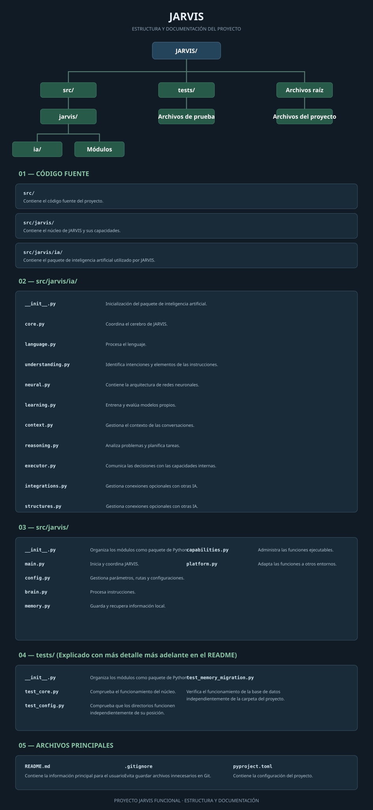

# JARVIS FUNCIONAL

## Propósito

JARVIS es un proyecto de asistente personal desarrollado principalmente en Python. Su objetivo es construir progresivamente una inteligencia artificial propia, capaz de comprender instrucciones, analizar información, aprender y ejecutar tareas mediante sus capacidades internas.

Uno de los objetivos del proyecto es permitir que el usuario pueda crear, entrenar, administrar y ejecutar redes neuronales sencillas mediante instrucciones de diálogo.
Se busca que jarvis sea capaz de pensar, mantener conversaciones, programar herramientas externas, con confirmación, mejorarse con una herramienta que el mismo programe a partir de lenguaje natural, o gestionar varias redes neuronales.

Se debe instalar con el
```powershell
python -m pip install -e .
```

## Versión

`v0.3.1`

## Estado del proyecto

JARVIS se encuentra actualmente en la **Fase 3: Cerebro e inteligencia**.

El sistema cuenta con un núcleo inicial, memoria persistente mediante SQLite y procesamiento básico de comandos. Actualmente dispone de tres comandos principales para interactuar con sus funciones iniciales.

El proyecto incluye una arquitectura modular para el desarrollo de su inteligencia, así como componentes propios para el procesamiento del lenguaje, la comprensión de instrucciones, el razonamiento básico y las redes neuronales.

El motor neuronal implementa una red multicapa básica con inferencia y entrenamiento. Sin embargo, estos componentes todavía no constituyen una inteligencia artificial conversacional completa.

La estructura de almacenamiento permite mantener los datos independientes de la ubicación del proyecto. Se contempla compatibilidad con Windows, Linux y macOS.

## Memoria persistente

La memoria inicial utiliza SQLite para almacenar información mediante una tabla con la siguiente estructura:

| Campo | Tipo | Uso |
|---|---|---|
| ID | INTEGER AUTOINCREMENT | Identificador único y orden de los registros. |
| Key | TEXT UNIQUE | Clave utilizada para identificar un dato. |
| Value | TEXT | Información almacenada como texto. |

Esta estructura constituye una implementación inicial. Podrá ampliarse conforme evolucionen las necesidades de memoria de JARVIS.

## Estructuras de comunicación

Se utilizan `dataclasses` de Python para establecer formatos estandarizados de comunicación entre los componentes.

### `InputData` — Entrada

- `text`: instrucción recibida (`str`).
- `timestamp`: momento de recepción (`datetime`).
- `source`: origen de la instrucción (`str`).

### `AnalysisResult` — Análisis

- `intent`: intención identificada (`str`).
- `entities`: elementos relevantes extraídos (`dict`).
- `confidence`: nivel de confianza estimado (`float`).
- `understood`: indica si la instrucción fue comprendida (`bool`).

### `Action` — Acción individual

- `name`: Nombre de la accion (`list[Action]`).
- `parameters`: Parametros necesarios para la acción. (`bool`).

### `ActionPlan` — Plan de acción

- `actions`: acciones propuestas (`list[Action]`).
- `requires_confirmation`: indica si se necesita autorización (`bool`).
- `reason`: justificación del plan (`str`).

### `ExecutionResult` — Resultado de ejecución

- `success`: indica si la ejecución fue exitosa (`bool`).
- `output`: resultado obtenido (`str`).
- `error`: información del error, si existe (`str | None`).

Estas estructuras permiten mantener una comunicación consistente, facilitar las pruebas y reducir las dependencias entre componentes.

## Organización de archivos

<p align="center">
  
</p>

> El proyecto continúa en una fase temprana de desarrollo. Su estructura y funcionalidades evolucionarán conforme avance su construcción.

## Hoja de ruta

### Fase 1 — Núcleo inicial
<sub>Completada</sub>

- Estructura inicial del proyecto.
- Detección del sistema y hardware.
- Memoria persistente con SQLite.
- Procesamiento básico de comandos.
- Pruebas automatizadas.

### Fase 2 — Portabilidad y configuración
<sub>Completada</sub>

- Almacenamiento adecuado para cada sistema operativo.
- Configuración centralizada.
- Rutas independientes de la ubicación del proyecto.
- Preparación para Windows y Linux.

### Fase 3 — Cerebro e inteligencia
<sub>En desarrollo</sub>

- Desarrollo de una inteligencia artificial propia.
- Selección de capacidades según el hardware disponible.
- Comprensión de instrucciones y razonamiento.
- Funcionamiento local y sin conexión siempre que sea posible.

Esta fase se divide en subfases para desarrollar y evaluar cada componente de manera independiente.

#### 3.1. Arquitectura de inteligencia
<sub>Completada</sub>

- Diseñar la estructura interna del cerebro de JARVIS.
- Definir los componentes y su comunicación.
- Establecer una arquitectura modular, independiente y ampliable.

#### 3.2. Procesamiento del lenguaje

- Implementar un sistema propio de procesamiento del lenguaje.
- Desarrollar tokenización y normalización de texto.
- Identificar palabras, estructuras y elementos relevantes de las instrucciones.

#### 3.3. Comprensión de intenciones

- Reconocer las intenciones del usuario.
- Identificar entidades, parámetros y contexto.
- Relacionar instrucciones con las capacidades de JARVIS.

#### 3.4. Motor neuronal propio

- Desarrollar las bases de una red neuronal desde cero.
- Implementar operaciones, capas y funciones de activación.
- Crear un sistema propio de inferencia.

#### 3.5. Entrenamiento y aprendizaje

- Implementar algoritmos propios de entrenamiento.
- Crear y entrenar modelos pequeños especializados.
- Evaluar resultados y mejorar los modelos mediante entrenamiento controlado.

#### 3.6. Memoria contextual

- Incorporar contexto a las conversaciones.
- Relacionar información actual con recuerdos anteriores.
- Mejorar la recuperación y utilización de información almacenada.

#### 3.7. Razonamiento y planificación

- Desarrollar mecanismos para analizar instrucciones.
- Dividir tareas complejas en pasos.
- Evaluar alternativas y seleccionar acciones.
- Gestionar errores y resultados inesperados.

#### 3.8. Integración con las capacidades de JARVIS

- Conectar la inteligencia con los módulos internos.
- Traducir decisiones en acciones.
- Validar resultados y gestionar respuestas.

#### 3.9. Integración opcional de modelos externos

- Permitir conexiones con modelos de inteligencia artificial externos.
- Crear una interfaz independiente del proveedor o modelo.
- Mantener el funcionamiento de las capacidades propias sin conexiones externas.
- Permitir activar o desactivar estas integraciones.

#### 3.10. Optimización y evaluación

- Optimizar el rendimiento y consumo de recursos.
- Evaluar precisión, velocidad y calidad de respuestas.
- Mejorar la compatibilidad con diferentes dispositivos.
- Realizar pruebas de funcionamiento sin conexión.

#### 3.11. Consolidación del cerebro

- Integrar todos los componentes de inteligencia.
- Verificar su funcionamiento conjunto.
- Documentar la arquitectura y los mecanismos de aprendizaje.
- Preparar el sistema para las siguientes fases del proyecto.

### Fase 4 — Sistema de voz

- Reconocimiento de voz.
- Síntesis de voz.
- Activación por voz, si el hardware lo permite.
- Conversación hablada.

### Fase 5 — Memoria avanzada

- Memoria a corto y largo plazo.
- Contexto de conversaciones.
- Organización y recuperación inteligente de información.
- Control del usuario sobre sus recuerdos.

### Fase 6 — Herramientas y automatización

- Ejecutar tareas locales autorizadas.
- Administrar archivos y carpetas.
- Automatizar tareas repetitivas.
- Sistema de permisos y confirmaciones.

### Fase 7 — Internet y conocimiento

- Acceso opcional a Internet.
- Búsqueda de información.
- Consulta de fuentes y verificación.
- Funcionamiento sin Internet cuando no sea necesario.

### Fase 8 — Interfaz y experiencia

- Interfaz gráfica.
- Panel de configuración.
- Historial de conversaciones.
- Personalización de voz y comportamiento.

### Fase 9 — Adaptabilidad y multiplataforma

- Detección de recursos disponibles.
- Ajuste automático de capacidades.
- Preparación para dispositivos de menor potencia.
- Evaluación de compatibilidad con Android.

### Fase 10 — Seguridad, optimización y distribución

- Protección de datos y permisos.
- Optimización de rendimiento.
- Pruebas de estabilidad.
- Instaladores y distribución gratuita.
- Documentación final.

## Principios del proyecto

- **Gratuito:** sin servicios de pago obligatorios ni suscripciones necesarias.
- **Local primero:** las funciones esenciales deben trabajar sin Internet siempre que sea posible.
- **Python como lenguaje principal:** dependencias externas únicamente cuando aporten un beneficio justificado.
- **Adaptable:** ajustar las capacidades al hardware disponible.
- **Portable:** evitar depender de una computadora o sistema operativo específico.
- **Privacidad:** los datos personales permanecen bajo el control del usuario.
- **Modular:** cada capacidad debe poder mantenerse, sustituirse o desactivarse independientemente.
- **Código limpio:** priorizar soluciones sencillas, eficientes y fáciles de mantener.

## Diseño de inteligencia artificial

### Objetivo

Desarrollar una inteligencia artificial propia desde cero, capaz de comprender instrucciones, analizar información, aprender y ejecutar tareas mediante las capacidades de JARVIS.

El sistema será independiente de modelos y servicios externos, aunque permitirá utilizarlos opcionalmente para ampliar sus capacidades.

### 1. Procesamiento y comprensión

- Procesamiento y normalización del lenguaje.
- Tokenización y análisis de texto.
- Identificación de intenciones del usuario.
- Reconocimiento de entidades, parámetros y contexto.
- Interpretación progresiva de instrucciones ambiguas o incompletas.

### 2. Inteligencia y razonamiento

- Desarrollo de mecanismos propios de razonamiento.
- Análisis de información y evaluación de alternativas.
- Planificación y división de tareas complejas.
- Selección de acciones según la intención y el contexto.
- Gestión de errores y situaciones inesperadas.

### 3. Redes neuronales propias

- Desarrollo de redes neuronales desde cero.
- Implementación de operaciones, capas y funciones de activación.
- Creación de modelos pequeños especializados.
- Implementación de mecanismos propios de inferencia.
- Optimización para diferentes capacidades de hardware.

### 4. Aprendizaje y entrenamiento

- Desarrollo de algoritmos propios de entrenamiento.
- Creación y preparación de conjuntos de datos.
- Entrenamiento de modelos especializados.
- Evaluación de precisión y rendimiento.
- Mejora de modelos mediante entrenamiento controlado.

### 5. Memoria y contexto

- Utilización de información almacenada para comprender instrucciones.
- Gestión del contexto de las conversaciones.
- Relación entre información actual y recuerdos anteriores.
- Recuperación de información relevante.
- Adaptación de las respuestas según el contexto disponible.

### 6. Ejecución de acciones

- Transformación de instrucciones en acciones.
- Validación de las acciones antes de ejecutarlas.
- Comunicación con las capacidades internas de JARVIS.
- Verificación de resultados.
- Gestión de permisos y confirmaciones cuando sean necesarias.

### 7. Integraciones externas opcionales

- Posibilidad de utilizar modelos de IA existentes.
- Compatibilidad con diferentes modelos y proveedores.
- Integración independiente del motor principal.
- Activación y desactivación de conexiones externas.
- Funcionamiento de las capacidades propias sin depender de estas integraciones.

### 8. Independencia y optimización

- Funcionamiento local y sin conexión a Internet.
- Ausencia de dependencias obligatorias de motores externos.
- Optimización del consumo de memoria y procesamiento.
- Adaptación a los recursos disponibles.
- Evaluación continua de precisión, velocidad y estabilidad.

### Principios de desarrollo

La inteligencia de JARVIS se desarrollará progresivamente, priorizando la comprensión de sus mecanismos internos y la creación de tecnología propia.

Se evitará depender de soluciones externas cuando sea posible, sin descartar su utilización opcional cuando aporten mejoras significativas.

El aprendizaje de los modelos será controlado y evaluado. La memoria de JARVIS y el entrenamiento de sus redes neuronales serán mecanismos independientes.

## Pruebas

El proyecto utiliza la biblioteca `unittest` de Python para realizar pruebas automatizadas de sus componentes.

Para ejecutar todas las pruebas desde la raíz del proyecto, utiliza el siguiente comando en PowerShell:

```powershell
python -m unittest discover -s tests -v
```
o bien el atajo de jarvis
```powershell
test_jarvis
```
### Listado de pruebas

#### `test_core.py` — 11 pruebas

| Nombre de la prueba | Qué verifica |
|---|---|
| `test_save_and_get_memory` | Guardar y recuperar información de la memoria. |
| `test_update_memory` | Actualizar información previamente almacenada. |
| `test_missing_memory` | Manejar la búsqueda de una clave inexistente. |
| `test_delete_memory` | Eliminar información de la memoria. |
| `test_empty_memory_values` | Rechazar valores vacíos al guardar información. |
| `test_remember_command` | Procesar el comando para recordar. |
| `test_retrieve_command` | Procesar el comando para recuperar información. |
| `test_empty_command` | Manejar instrucciones vacías. |
| `test_help_command` | Mostrar la ayuda de JARVIS. |
| `test_system_detection` | Detectar el sistema operativo. |
| `test_capabilities` | Verificar las capacidades detectadas del sistema. |
|`test_remember_command`|Hace una prueba con el comando probar.|

#### `test_neural.py` — 8 pruebas

| Nombre de la prueba | Qué verifica |
|---|---|
| `test_network_creation` | Creación correcta de una red neuronal. |
| `test_prediction_output_size` | Cantidad correcta de valores de salida. |
| `test_default_sigmoid_range` | Que las salidas de la función sigmoid estén entre 0 y 1. |
| `test_reproducible_with_seed` | Que una misma semilla produzca resultados reproducibles. |
| `test_invalid_layer_sizes` | Rechazo de arquitecturas con dimensiones inválidas. |
| `test_invalid_activation` | Rechazo de funciones de activación no admitidas. |
| `test_invalid_input_size` | Rechazo de entradas con dimensiones incorrectas. |
| `test_invalid_input_values` | Rechazo de entradas no numéricas o no finitas. |

#### `test_executor.py` — 8 pruebas

| Nombre de la prueba | Qué verifica |
|---|---|
| `test_execute_confirmed_action` | Ejecución de una acción después de recibir confirmación. |
| `test_confirmation_required` | Bloqueo de acciones que no han sido confirmadas. |
| `test_execute_with_parameters` | Entrega correcta de parámetros a la acción ejecutada. |
| `test_unknown_action` | Rechazo de acciones que no están registradas. |
| `test_empty_plan` | Manejo de planes sin acciones. |
| `test_execution_error` | Manejo de errores durante la ejecución. |
| `test_invalid_plan` | Rechazo de planes que no sean objetos `ActionPlan`. |
| `test_invalid_confirmation` | Rechazo de valores de confirmación incorrectos. |

#### `test_reasoning.py` — 11 pruebas

| Nombre de la prueba | Qué verifica |
|---|---|
| `test_help_plan` | Generación de un plan para mostrar ayuda. |
| `test_remember_plan` | Generación de un plan para guardar información. |
| `test_unknown_plan` | Manejo de intenciones desconocidas. |
| `test_default_confirmation` | Verifica que las acciones requieran confirmación por defecto. |
| `test_invalid_input` | Rechazo de entradas que no sean objetos `AnalysisResult`. |
|`test_unknown_plan_preserves_context`|Revisa si conserva el contexto.|
|`test_low_confidence_does_not_propose_action`|revisa que poca confianza no proponga una acción.|
|`test_confidence_at_threshold_allows_action`|Revisa que con la confianza suficiente se reallize la acción.|
|`test_custom_minimum_confidence`|Revisa que se pueda modificar la confianza minima.|
|`test_invalid_minimum_confidence`|Prueba el rechazo ante una confianza invalida.|
|`test_invalid_analysis_confidence`|Prueba el rechazo ante una confianza invalida (en el analisis).|
|`test_integration_plan_uses_requested_handler`|Prueba que el diseño del plan tome en cuenta los comandos.|
|`test_integration_plan_rejects_missing_name`|Prueba que un comando sin nombre no se ejecute.|
|`test_integration_plan_rejects_invalid_name`|Prueba que un comando sin un nombre valido no se ejecute.|

#### `test_config.py` — 5 pruebas

| Nombre de la prueba | Qué verifica |
|---|---|
| `test_windows_data_directory` | Obtener el directorio de datos en Windows. |
| `test_windows_fallback_directory` | Utilizar una ruta alternativa en Windows cuando sea necesario. |
| `test_macos_data_directory` | Obtener el directorio de datos en macOS. |
| `test_linux_data_directory` | Obtener el directorio de datos en Linux. |
| `test_linux_fallback_directory` | Utilizar una ruta alternativa en Linux cuando sea necesario. |

#### `test_memory_migration.py` — 3 pruebas

| Nombre de la prueba | Qué verifica |
|---|---|
| `test_migration_preserves_memory` | Comprobar que los datos se conservan durante la migración. |
| `test_legacy_database_is_preserved` | Verificar que la base de datos anterior no se elimina. |
| `test_existing_database_is_not_overwritten` | Evitar sobrescribir una base de datos existente. |

#### `test_language.py` — 10 pruebas

| Nombre de la prueba | Qué verifica |
|---|---|
| `test_normalize_text` | Normalizar espacios y convertir el texto a minúsculas. |
| `test_tokenize` | Dividir el texto en palabras y signos de puntuación. |
| `test_prepare_text` | Preparar correctamente el texto normalizado. |
| `test_invalid_input` | Rechazar entradas que no sean cadenas de texto. |
| `test_normalize_for_matching` | Normaliza palabras eliminando tildes. |
| `test_normalize_for_matching_preserves_enye` | Conserva correctamente la letra ñ. |
| `test_normalize_for_matching_preserves_umlaut` | Normaliza la diéresis. |
| `test_normalize_for_matching_multiple_accents` | Normaliza múltiples palabras con tildes. |
| `test_tokenize_unicode` | Comprueba la separación de texto Unicode y puntuación. |
| `test_tokenize_empty_text` | Comprueba el procesamiento de entradas vacías. |

### `test_understanding.py` — 20 pruebas <sub>Archivo con más pruebas</sub>

| Prueba | Descripción |
|---|---|
| `test_help_intent` | Reconoce la intención de solicitar ayuda. |
| `test_exit_intent` | Reconoce la intención de salir. |
| `test_remember_intent` | Identifica solicitudes para guardar información. |
| `test_recall_intent` | Identifica solicitudes para recuperar información. |
| `test_unknown_intent` | Maneja intenciones desconocidas. |
| `test_empty_input` | Maneja entradas vacías. |
| `test_invalid_input` | Rechaza entradas que no sean InputData. |
| `test_help_variations` | Reconoce distintas expresiones de ayuda. |
| `test_exit_variations` | Reconoce distintas expresiones de salida. |
| `test_remember_empty_key` | Rechaza solicitudes sin clave. |
| `test_remember_empty_value` | Rechaza solicitudes sin valor. |
| `test_recall_empty_key` | Rechaza solicitudes de recuperación sin clave. |
|`test_context_parameter_is_optional`|Verifica que el parametro de contexto del entendimiento de jarvis sigue siendo opcional.|
|`test_context_is_used_for_unknown_intent`|Prueba que el contexto sea utilizado.|
|`test_relevant_context_is_added_to_entities`|Comprueba que el contexto se agrega a entities.|
|`test_empty_context_does_not_add_entity`|Se fija en si al dar contexto vacio, sigue añadiendose a entities.|
|`test_context_is_not_used_for_known_intents`|Se fija en que si las intenciones de inicio está en blanco, no se llame el contexto.|
|`test_context_is_not_used_for_empty_input`|Se fija en que si la entrada está en blanco, no se llame al contexto.|
|`test_invalid_context`|Se observa el comportamiento, cuando el contexto tiene un error.|
|`test_context_preserves_original_command_behavior`|Se fija en que el contexto no afecte el desarrollo de otras entidades.|
| `test_registered_integration_intent` | Reconocer una orden que solicita ejecutar una integración registrada. |
| `test_registered_integration_is_case_insensitive` | Reconocer nombres de integraciones sin distinguir mayúsculas y minúsculas. |
| `test_unknown_integration_is_not_recognized` | Rechazar integraciones que no existen en el registro. |
| `test_integration_command_requires_registry` | Evitar reconocer integraciones cuando no se proporciona un registro. |
| `test_invalid_available_integrations` | Rechazar registros de integraciones con tipos inválidos. |

#### `test_learning.py` — 8 pruebas

| Nombre de la prueba | Qué verifica |
|---|---|
| `test_training_reduces_loss` | Que el entrenamiento reduzca el error de la red. |
| `test_training_returns_history` | Que se registre el error de cada época. |
| `test_invalid_network` | Rechazo de objetos que no sean redes neuronales. |
| `test_invalid_epochs` | Rechazo de cantidades de épocas inválidas. |
| `test_invalid_learning_rate` | Rechazo de tasas de aprendizaje inválidas. |
| `test_mismatched_dataset_size` | Rechazo de conjuntos con distinta cantidad de entradas y objetivos. |
| `test_invalid_dimensions` | Rechazo de entradas y objetivos con dimensiones incorrectas. |
| `test_non_finite_values` | Rechazo de datos con valores infinitos. |

### `test_ai_core.py` — 17 pruebas

| Prueba | Descripción |
|---|---|
| `test_process_input` | Verifica la integración del análisis y generación de planes. |
| `test_unknown_intent` | Verifica el manejo de intenciones desconocidas. |
| `test_add_input_history` | Comprueba el registro de entradas en el historial. |
| `test_history_limit` | Verifica el límite de almacenamiento del historial. |
| `test_clear_history` | Comprueba la limpieza del historial. |
| `test_execute_confirmed_action` | Verifica la ejecución de acciones autorizadas. |
| `test_confirmation_required` | Comprueba que las acciones requieran autorización. |
| `test_invalid_input` | Verifica el rechazo de entradas incorrectas. |
| `test_invalid_handlers` | Comprueba la validación de los manejadores. |
| `test_invalid_plan` | Verifica el rechazo de planes incorrectos. |
|`test_find_relevant_context`|Verifica que la funcion `find_relevant_context()` se pueda llamar desde el nucleo.|
|`test_find_relevant_context_forwards_min_score`|Verifica que el contexto obedezca la puntucación minima.|
|`test_get_relevant_context_returns_text`|Verifica que se pueda llamar la creación de texto conversacional.|
|`test_get_relevant_context_forwards_min_score`|Verifica que la creación de texto conversacional obedezca la puntuacion minima.|
|`test_process_input_uses_conversation_context`|Revisa si el nucleo usa el contexto para analizar la entrada.|
|`test_get_relevant_context_returns_formatted_text`|Revisa que el nucleo sea capaz de obtener texto conversacional.|
|`test_get_relevant_context_respects_min_score`|Revisa que el contexto respete la puntuacion minima.|

#### `test_context.py` — 15 pruebas

| Nombre de la prueba | Qué verifica |
|------|--------|
| `test_add_input` | Añadir entradas al historial de conversación. |
| `test_get_recent` | Recuperar las entradas más recientes. |
| `test_max_history` | Respetar el límite máximo del historial. |
| `test_clear` | Limpiar el historial de conversación. |
| `test_invalid_input` | Rechazar entradas que no sean objetos `InputData`. |
| `test_invalid_history_limit` | Rechazar límites de historial inválidos. |
|`test_find_relevant_matches_case_insensitively`|Verifica que la funcioón `Find_relevant()` solo devuelva textos que sean relevantes.|
|`test_find_relevant_respects_min_score`|Verifica que solo se devuelvan los textos que cumplan la puntuacion minima|
|`test_find_relevant_respects_limit`|Verifica que al buscar los relevantes se respete el limite de mensajes fijado, configurable.|
|`test_find_relevant_empty_or_unmatched_query`|Verifica que cuando el texto esté vacío no devuelva nada.|
|`test_find_relevant_invalid_query`|Revisa que sin un texto, levante un `TypeError`.|
|`test_find_relevant_invalid_min_score_type`|Revisa que se levante un `TypeError` al insertar una puntuacion minima invalida.|
|`test_find_relevant_invalid_min_score_range`|Revisa que un valor negativo o superior a uno levanten un `ValueError`. |
|`test_get_relevant_context_formats_results`|Revisa que la función pueda convertir el contexto a texto conversacional.|
|`test_get_relevant_context_respects_min_score`|Revisa que funcione la generacion de texto conversacional a partir de un texto y la busqueda de historial relevante.|

#### `test_integrations.py` — 11 pruebas

| Nombre de la prueba | Qué verifica |
|---|---|
| `test_register_and_get_handler` | Comprobar que una integración se registra y puede recuperarse. |
| `test_register_rejects_empty_name` | Evitar registrar integraciones con nombres vacíos. |
| `test_register_rejects_non_callable` | Impedir registrar objetos que no sean funciones ejecutables. |
| `test_register_rejects_duplicate_without_replace` | Evitar sobrescribir integraciones existentes accidentalmente. |
| `test_register_can_replace_handler` | Comprobar que se puede reemplazar una integración explícitamente. |
| `test_unregister_existing_handler` | Verificar que una integración existente puede eliminarse. |
| `test_unregister_missing_handler` | Comprobar que eliminar una integración inexistente devuelve `False`. |
| `test_get_handlers_returns_copy` | Verificar que obtener las integraciones no permite modificar el registro original. |
| `test_invalid_initial_handlers` | Rechazar valores inválidos al inicializar el registro. |
| `test_invalid_replace_flag` | Rechazar valores no booleanos en el parámetro `replace`. |
| `test_length` | Comprobar que se devuelve la cantidad correcta de integraciones registradas. |

#### `test_brain_integrations.py` — 9 pruebas

| Nombre de la prueba | Qué verifica |
|---|---|
| `test_register_integration` | Comprobar que una nueva integración se registra correctamente. |
| `test_registered_integration_can_be_executed` | Verificar que JARVIS puede ejecutar una integración registrada. |
| `test_duplicate_integration_is_rejected` | Evitar registrar integraciones duplicadas accidentalmente. |
| `test_integration_can_be_replaced` | Comprobar que una integración puede reemplazarse explícitamente. |
| `test_unregister_integration` | Verificar que una integración existente puede eliminarse. |
| `test_unregister_missing_integration` | Comprobar que eliminar una integración inexistente devuelve `False`. |
| `test_invalid_integration_name` | Rechazar nombres de integración vacíos. |
| `test_invalid_integration_handler` | Rechazar manejadores que no sean funciones ejecutables. |
| `test_get_integrations_returns_copy` | Evitar que modificar la copia de integraciones altere el registro original. |

**#### `test_brain_confirmation.py` — 9 pruebas**

| Nombre de la prueba | Descripción |
|---|---|
| `test_plan_is_shown_before_execution` | El plan se presenta antes de ejecutarse. |
| `test_s_authorizes_only_one_action` | S autoriza solamente una acción. |
| `test_o_authorizes_all_remaining_actions` | O autoriza todas las acciones restantes. |
| `test_o_authorizes_all_actions_from_the_beginning` | O autoriza todas las acciones desde el inicio. |
| `test_n_cancels_remaining_actions` | N cancela las acciones pendientes. |
| `test_invalid_answer_keeps_plan_pending` | Una respuesta inválida mantiene el plan pendiente. |
| `test_new_instruction_is_not_processed_while_plan_is_pending` | Impide procesar instrucciones nuevas durante la confirmación. |
| `test_s_without_pending_plan_does_not_execute_actions` | Impide ejecutar acciones sin un plan pendiente. |
| `test_execution_failure_clears_pending_plan` | Limpia el plan cuando ocurre un error de ejecución. |

**Total: 153 pruebas automatizadas documentadas.**

Las pruebas permiten verificar el funcionamiento de los componentes, detectar errores y comprobar que las modificaciones no afecten funcionalidades existentes. Se incorporarán nuevas pruebas conforme avance el desarrollo.

> La cantidad indicada corresponde a las pruebas documentadas; su estado de ejecución debe verificarse mediante el comando anterior.

---

Proyecto iniciado con fines principalmente educativos, de investigación y desarrollo.